---

title: "Gripp"
author: "phantom-ascii"
description: "A beautifully simple robot arm"
created_at: "2026-10-26"

---

# Oct 26 IK i started another project but welp

IDK why im started *another project* but oh well. I wanted to get a bit into robotics and what better way to dabble than to do. Anyways i want to make a rly simple robot arm that works... (none of my hardware projects so far have worked so welll yhhh). Also wanna see how well i can 3d model this cause my skills arnt that good... anyways heres a picture of what im trying to make

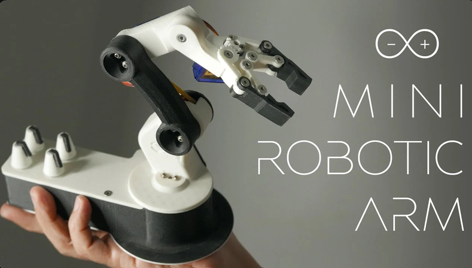

@geeky-gadgets for the image

**Total time spent: 0 minutes**

# Oct 27 I have finished the schematics

WOW that took quite a while. I started the project i froze the mvp.I want a 4 axis simple robotic arm featuring the xiao rp2040 mcu. I also want 5 mx keys to control and switch modes of the actual arm. For the schematics i decided to separate it into nicely done 4 sections. i firstly started the power system using gemini to help and claude to check schematics. After going back and forth with the two ais i finally finished what i think is the finalized schematics. Luckily i got 0 errors on my erc on my *first try* (rly proud of that). I used gemini to mainly block out what i want in the actual schematics and what connects to what/ i then would send screenshots with context to claude so it could check for any errors missed by gemini. I found working with two ais is better than one so hallucination occurs less, one ai can fact check the other and if an ai is biased in a certain way the second ai will not follow those traits and will give unbiased opinions. 

Full Schems:
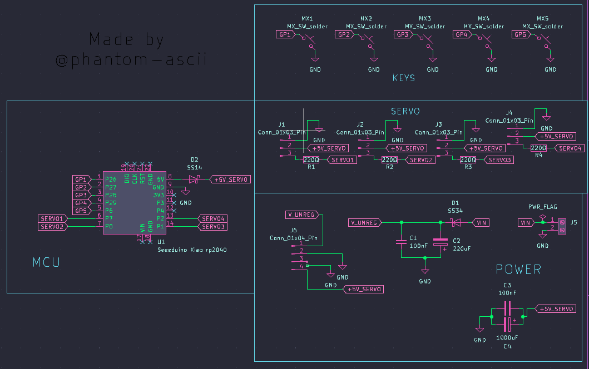

MCU:
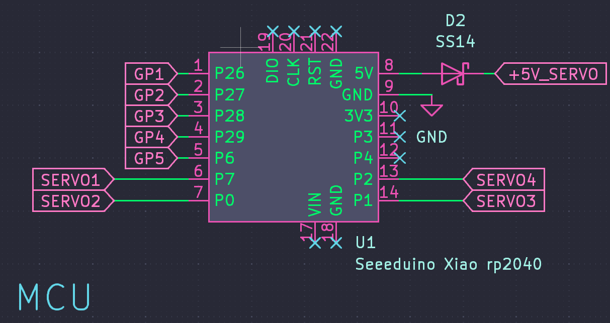

Power:
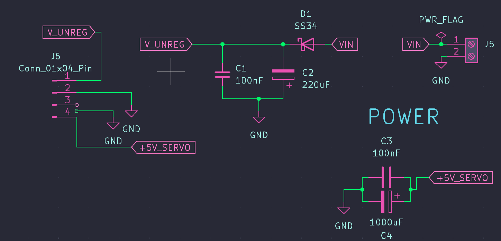

Input/Output:
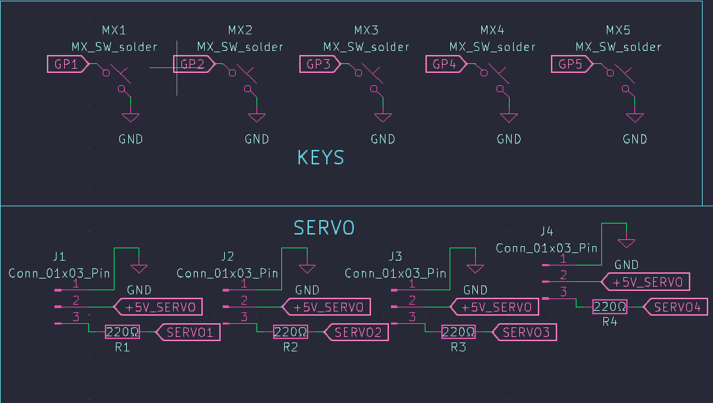

Im going to work on my PCB design next. I think doing the pcb before the actual 3d modeling is smarter so then i can build an enclosure and a model reflecting the actual pcb rather than estimated dimensions. However one thing i am worrying is that my pins are not ordered correctly, for example for my servos i have a 3 pin and i get a different layout (5v, gnd and data) every time i search it up so i just choose the most frequently used layout online. Im worrying about this alot cause my github.com/phantom-ascii/S.O-Dongle project had a similar bug and the oled would just fry itself if i used it. hopefully everything works tho. **Till next time!**

**Total time spent: 2 hours**

# Oct 27 Finished the main board
That was much easier than i though making the pcb was actually so flipping easy it just took a while. i started by assignign footprints wihch may have been the hardest bit of this project using claude and firefox to find the footprints i need i then moved onto assignign 3d models. idk about you but i neeeeeed to assign 3d models to my components. Seeing an accurate 3 version of your pcb is just so satisfying. I then started with placement. I placed the 4 input keys in a cluster and the *shift key thing* sparatly on the right of the board. i put the xiao in the bottom left and out of the way so tracing would be easier and i pu the 4 servos output at the top of the board leavign sufficent space for the actual plastic headers to clip in. i put my screw terminal in the bottom left keeping it close to the other power components to keep the 2mm power traces short and simple:

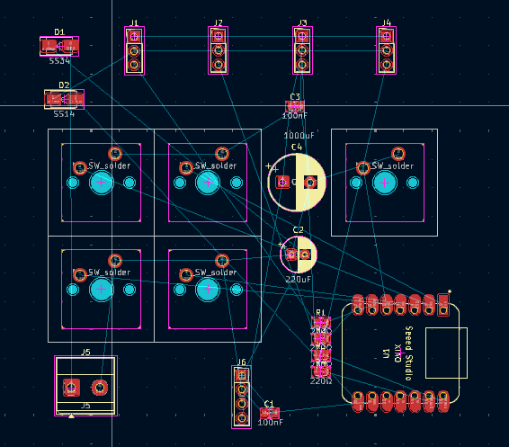

I think in the whole pcb i only used 2 vias wich i think is a flex. I then started by tracing which was easy enough. I sytarted with the main power rails such as vin and 5v (not gnd as i would have a gnd pour on the front and back copper) which were all 2mm width by using different netclasses. the rest of the tracks were 0.3 mm. I put all power rail tracks on f.cu and most other tracks on the b.cu. I ran a quick drc and fixxed a quick problem where my gnd fill was split into two islands. I fixxed it by just increasing the boards length tso the fill could go around traces and reach the other island as shown here:

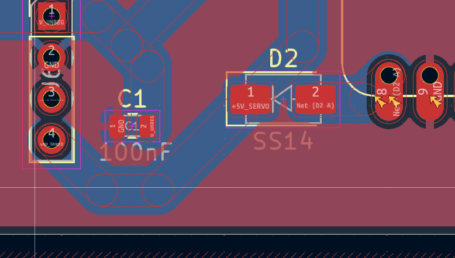

and got 0 errors on drc:

final board traced:

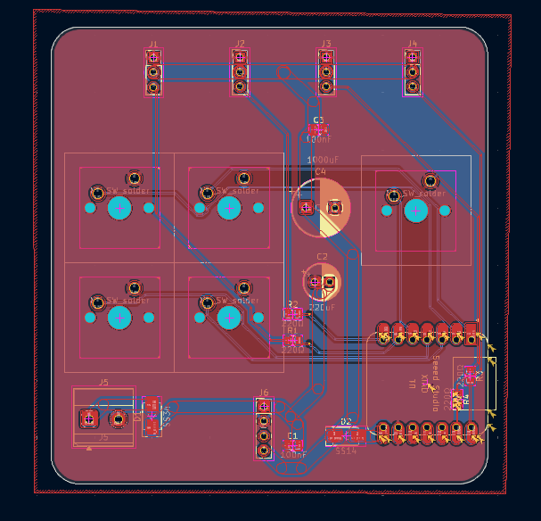
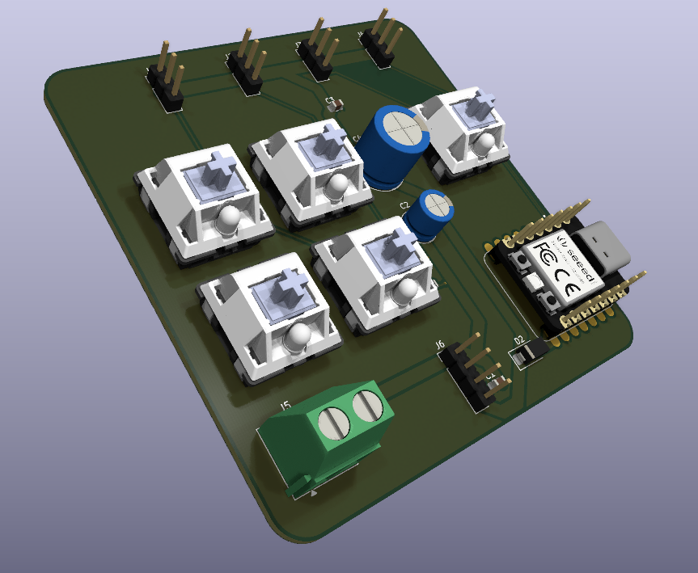

I then snatched an image from pinterest for the desing on the back of the pcb and added the hack club orhpeus flag:

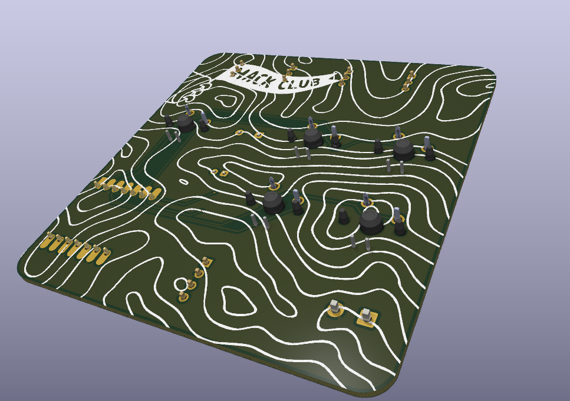

I also added a bit of silkscreen on the front of the pcb:

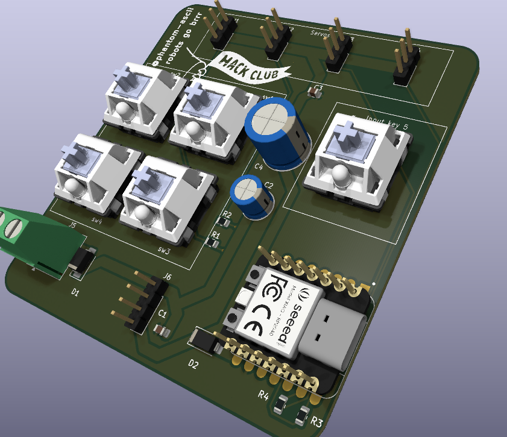

This is the final board:

Then I used a kicad fabrication mod and generated the gerbers, drill files plotters ect and after a few git this git that committed everything to my github. *ik i need to work on the read me*

i forgot about lapse so i only lapsed like 40 mins and then another 40 mins before but cause i wasnt lapsing ill only cant 30 mins

**Total time spent: 1 hours 10 mins**

# Oct 27 - 28 I started the 3d models and finished the enclosure
Wow that took most of my evening. I spent a good 3 hrs and more on this and i hope yall like it. I added so much more polish to this than my other projects and i think it turned out really nice. I started by centring the pcb in an assembly (at first i used a stl exort but it wouldnt centre with a fastened mate so im using a pcb step model instead now) and making a simple shell around the pcb. I then added a few cutouts for the Terminal wires, the usb-c xiao port and the output servo header wires. I added walls at varying height for design and so that you can actually click the keys down. Then i made a little nice looking over hang over the header wire slot so that idk icl im waffling i just added cause i thought it looked nice. I then added the lid and started polishing it for like 1 hour. This is where i learnt how to put text into a sketch put onshapes tool for this is a bit clunky tbf. Anyways heres some pictures:

PCB (stl):

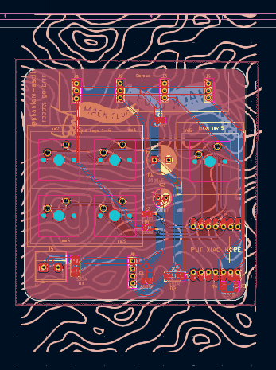

Almost finished enclosure:

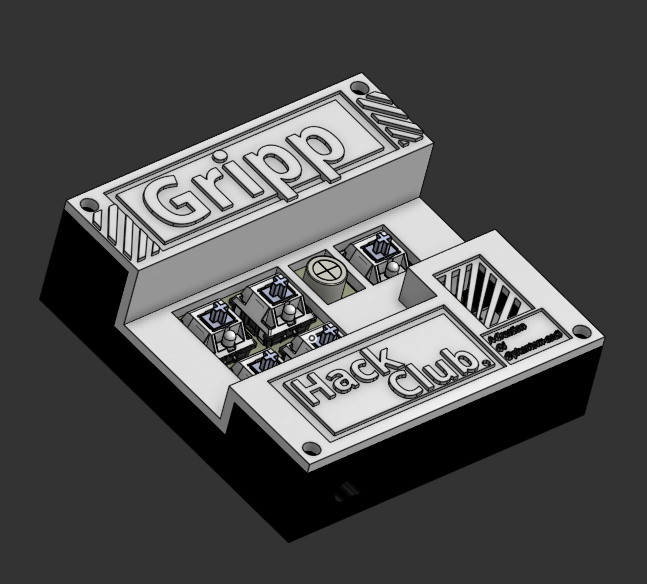

Lid:

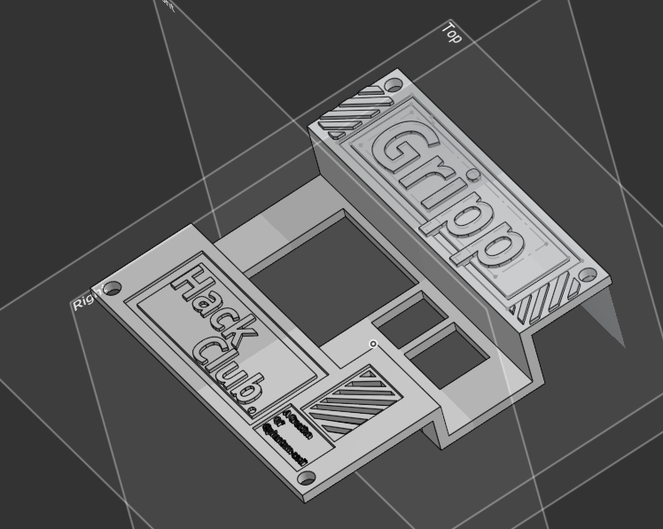

Shell and pcb (step)

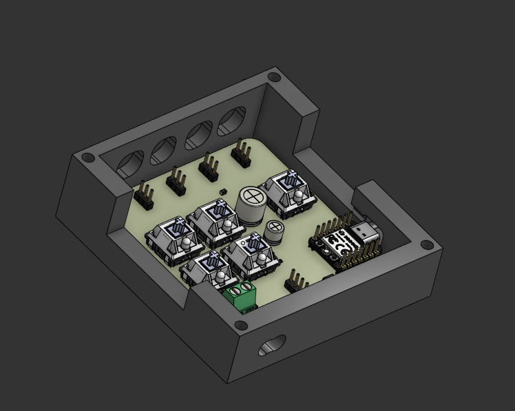

Terminal wire hole:

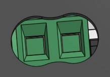

Usb-c hole:

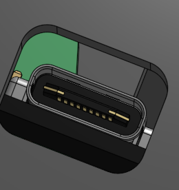

Back servos wire hole:

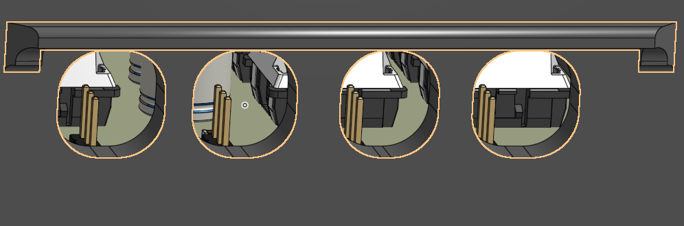

Warning decoration:

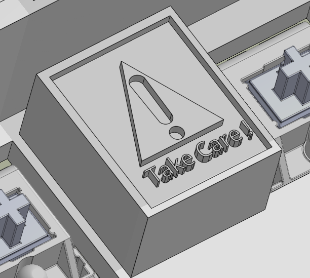

Screw:

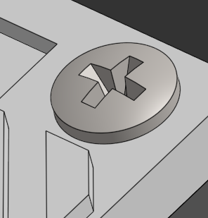

Finalised (hopefully) enclosure:

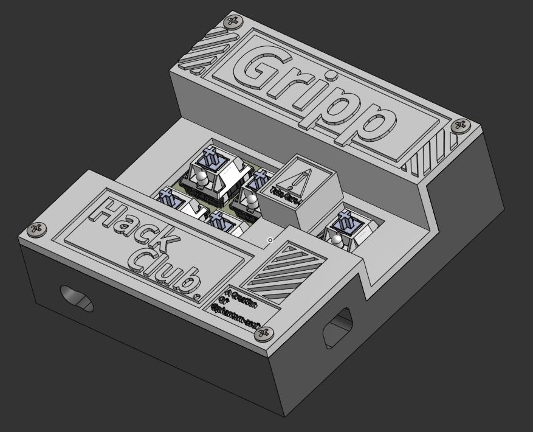

psst ik i said that i finished the enclosure but imma quickly spend like 10 mins chamfering and filetting everything.

did like 2hrs lapsed and like 1 ish without cause i 4got lol

**Total time spent: 3 hours 15 mins**

# Oct 28 Done a bit of chamfering and filleting and a designing
I added a few chamfers and fillets and added a quick designing on he bottom, not much else to say so here's the image. For the wavy design on the bottom i used onshapes spline tools and then drew a few random lines. I then used the text function to add the text on bottom.

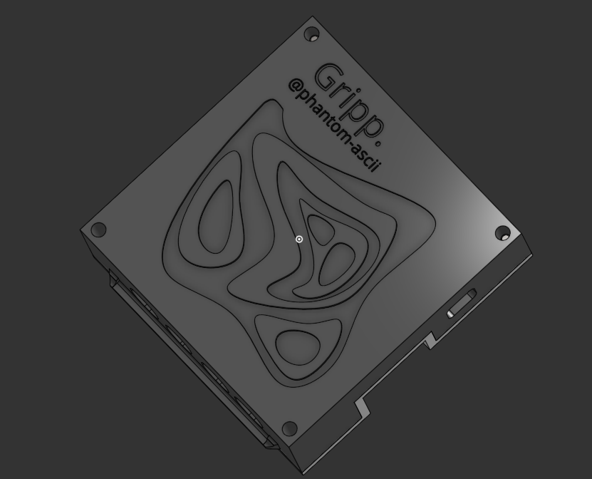

**Total time spent: 30 minutes**

# Oct 28 Started the actual arm model
So for 3d modelling the arm im using onshape again and omfd i was like 2 hrs into the project when i made so stupid ahh mistake and had to restarr. Basically i was making a circualr base for the robot arm that would rotate around the stepper motor horn but after finishing everything (2hrs in) i realized that my horn wasnt in the midle but rather i centred the whole module in the centre this meant that when the motor spinned the circular base would spin around the horn point rather from the middle of the circle. i then restarted. I got the stpper motor module off of grabcad and imported that into an assembly. I then made my base with that as the context and then the two lid parts(the actuall spinnign circular plate and the plate that holds the circular one) with context of the horn and the base. i put 4 m3 heat insert set sizes in 4 corners so the lid can screw onto the base and im going to add a system where the circualr plate stays in plate. the reason this journal is very long is cause i spent 2 hours making a faulty modle and then another 2 hours making it from scratch. I think i lapsed around 2-3 hours of the total time so this moght get deflated by reviewers :( Tip for next time LAPSE everything you stupid *idiot* . Anyways im worrying that the stepper motor horn ,ight break from all the torque cause this bottom one is essentially moving the whole arm by itself and idk if it can handle that and if it doestn im worrying that the actual gear of the motor holding the horn will strip or the lid will crack. Idk how tf to testthis so lets just hope for the best. Anyways heres what it looks likes rn:

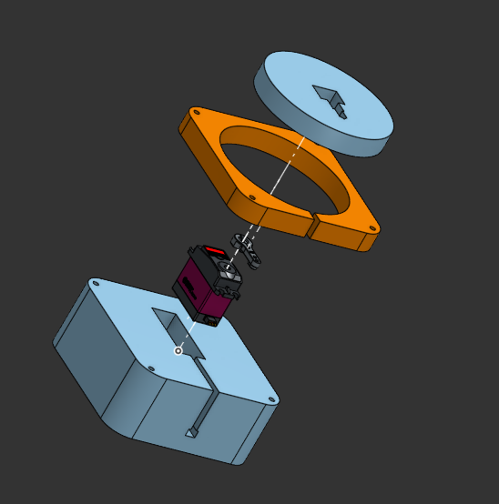

Btw i just learnt how to use exploded view and its kinda cool

**Total time spent: 4 hours**
